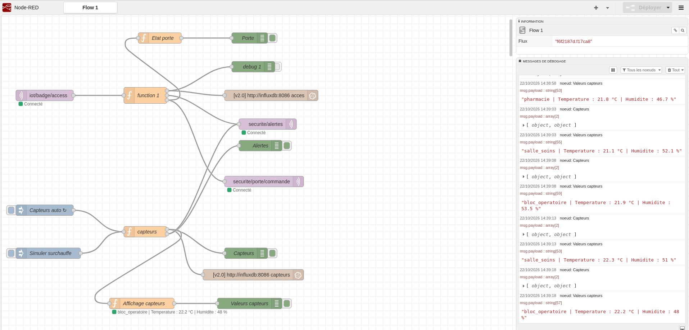
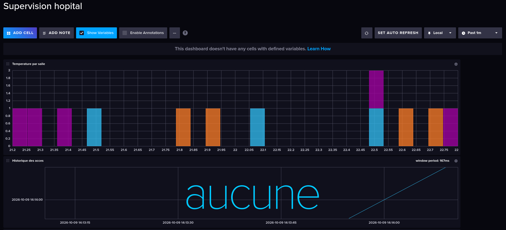

# SAE – Hôpital de campagne : contrôle d'accès par badge et supervision

Projet de SAE (BUT Réseaux et Télécommunications, IUT Nord Franche-Comté). Chaîne IoT de contrôle d'accès par badge pour un hôpital de campagne, avec détection d'anomalies et supervision en temps réel.

Vidéo de démonstration : https://youtu.be/m2cwiAwQjhk

## Mon rôle

J'ai réalisé la partie MQTT et sécurité : conception de la chaîne de contrôle d'accès par badge (ESP32, MQTT, Node-RED, InfluxDB), règles de décision et de détection d'anomalies, capteurs simulés et tableau de bord de supervision.

## Architecture

ESP32 + lecteur PN532 → MQTT (Mosquitto) → Node-RED → InfluxDB

- Le lecteur de badge (ESP32 Huzzah32 + PN532) lit l'identifiant du badge et le publie en MQTT.
- Node-RED compare le badge à la liste des badges autorisés, décide si l'accès est accordé et renvoie l'ordre d'ouverture ou de refus au lecteur.
- InfluxDB enregistre les accès et les mesures des capteurs simulés pour la supervision.

## Démonstration

Flux Node-RED (décision, alertes, capteurs simulés) :

Tableau de bord de supervision InfluxDB :

## Topics MQTT

- `iot/badge/access` : badge lu par le lecteur
- `securite/alertes` : alertes de sécurité
- `securite/porte/commande` : ordre d'ouverture ou de refus envoyé au lecteur

## Détection d'anomalies

| Anomalie | Règle | Sévérité |
|---|---|---|
| brute_force | 5 refus ou plus en 60 secondes | critique |
| badge_inconnu | badge absent de la liste | critique |
| acces_non_autorise | badge connu, mais salle non autorisée | avertissement |
| temperature_elevee | température supérieure à 28 °C | critique |
| humidite_elevee | humidité supérieure à 75 % | avertissement |

## Données dans InfluxDB

- `acces` : décision (porte ouverte ou aucun accès), utilisateur, rôle, salle, badge, sévérité, anomalie
- `capteurs` : température, humidité, mouvement (valeurs simulées par Node-RED)

## Compétences mises en oeuvre

MQTT, Node-RED, InfluxDB, Docker et Docker Compose, ESP32 (Arduino), lecture de badges NFC (PN532), supervision, détection d'anomalies, sécurité des réseaux IoT.

## Limites et améliorations possibles

Le projet est une démonstration. Pour une utilisation réelle, il faudrait :

- activer l'authentification MQTT (utilisateur et mot de passe) : le broker accepte ici les connexions anonymes ;
- chiffrer les échanges avec TLS (MQTT sur le port 8883) ;
- limiter les droits de chaque client avec des ACL Mosquitto ;
- stocker la liste des badges dans une base de données plutôt que dans la mémoire de Node-RED ;
- remplacer les capteurs simulés par de vrais capteurs.

## Lancer le projet

Dans le dossier node-red, lancer : docker compose up -d

Importer ensuite flows.json dans Node-RED (menu, Importer).

Avant de téléverser le code ESP32, renseigner le nom du WiFi, son mot de passe et l'adresse IP du broker MQTT. Les valeurs du dépôt sont des exemples à remplacer.

## Contenu du dépôt

- `esp32/` : code Arduino du lecteur de badge
- `node-red/` : docker-compose.yml, configuration Mosquitto et flux Node-RED (flows.json)
- `docs/` : captures d'écran

## Auteure

Aminata Yabre – BUT R&T, IUT Nord Franche-Comté
